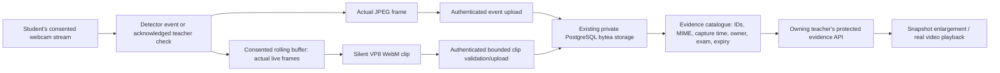

# ExamOS Vision — evidence visibility and dashboard upgrade

## What was actually wrong

The checked live teacher account returned **zero proctoring events** from `/api/proctor/live` at the start of this investigation. Its examination sessions were ended, and the connected device had no active camera/snapshot consent. There were no saved media records for that account to retrieve. Previously reported hardware tests used isolated databases and deliberately deleted their temporary camera evidence; those captures were never a permanent gallery in the main teacher account.

Code inspection found additional reproducible usability and pipeline gaps:

1. A webcam preview was easy to confuse with saved evidence. Camera access alone does not authorize storing a snapshot or clip, and normal preview frames are not permanent recordings.
2. The student's **Send camera check** button silently did nothing when its camera/snapshot prerequisites were not met. Manual checks also went through the incident cooldown and could be acknowledged as throttled without a saved-image confirmation.
3. There was no teacher-requested camera check. A teacher could not verify capture from the dashboard without waiting for a detector event or asking the student to use their local button.
4. Saved images/videos were accessible only through incident buttons; there was no dedicated media catalogue/gallery, stable evidence ID, search/filter API or explicit metadata for each media item.
5. The UI did not clearly separate waiting, stored, missing, deleted, expired and unavailable media. Old agent versions could not acknowledge a dashboard check.

The existing authenticated bytea retrieval path was functional when an actual uploaded record existed. I did not find a public-file permission setting that could make nonexistent evidence appear. The fix preserves that protected database storage and makes the complete capture/retrieval path explicit and verifiable. Deleted test footage cannot be recovered or replaced with fabricated examples.

## Implemented flow



Teacher checks never start a camera, grant consent, or enable storage remotely. They require a connected agent, recent heartbeat, started assigned examination, active camera consent and separate snapshot consent. The student receives visible capture/upload feedback. An outdated agent produces an acknowledgement error with an update/reconnect instruction; a disconnected, unconsented or completed-exam device cannot be captured.

Clips still require a third, separate opt-in. The existing camera stream is reused. The rolling buffer contains successive real webcam frames; no single image is looped or padded to manufacture a video. No audio or continuous footage is written to disk. Default coverage is approximately five seconds before and five after detection/check. Early events have less pre-event history; actual timing and duration are recorded and shown. Interrupted/pending clips are discarded on withdrawal/end and reported honestly.

## Database and storage

Migration `006_evidence_catalog.sql` was applied after backing up the existing persistent local database. Original students, enrollments, papers, attempts and event/review history remain in place.

- `evidence_assets`: stable evidence UUID; original event UUID; owning teacher; enrolled student/device UUID; session UUID; examination-attempt UUID; snapshot/clip kind; MIME; storage location; capture timestamp and its provenance; byte size; expiry and availability status. Existing stored media is backfilled without inventing missing bytes.
- `camera_check_requests`: persistent request UUID, teacher/device/session association, expiry, acknowledgement/capture/failure state and resulting event link.
- Snapshot/event/catalogue creation is atomic. Clip upload/catalogue creation is atomic. Metadata cannot report a successfully stored new asset if its database write fails.

Media remains in the existing `proctor_events.evidence` and `.clip` bytea columns. A location such as `postgresql:proctor_events/<event-id>/evidence` is an exact private database locator, **not a public URL or a fictitious disk file**. New capture timestamps come from the actual frame capture; old snapshot timestamps are honestly marked as derived from detection time when no earlier capture timestamp existed.

Expiry immediately denies retrieval and the existing sweep deletes expired bytes. Individual deletion removes the selected snapshot or clip separately. Incident-wide deletion, with confirmation, removes both. Original incident and review/audit metadata remain. Missing bytes return an explicit unavailable response rather than a broken placeholder image. Existing disk/database backups require the institution's own retention controls; the application cannot erase external backup copies.

## API endpoints

All teacher routes below are under `/api/proctor` and require the owning teacher's bearer token.

| Method/path | Behavior |
| --- | --- |
| `GET /evidence` | Paginated actual media metadata; `studentId`, `sessionId`, `eventId`, `kind`, `category`, `from`, `to`, `search`, `status`, `limit`, `offset` filters |
| `GET /evidence/:id/content` | Private JPEG or WebM with the correct MIME, no-store headers and access audit; 404 for unknown/foreign items, 410 for unavailable/deleted/expired media |
| `DELETE /evidence/:id` | Authorized individual-media deletion, with UI confirmation and audit |
| `POST /devices/:id/camera-check` | Request a real frame from an already-consented active camera; 202 means acknowledged and waiting, **not** already saved |
| `GET /summary` | Real exam, authenticated connection, camera, pending-incident, snapshot and video counters plus teacher profile |
| `GET /incidents` | Paginated full detection history instead of silently stopping at the latest 200 incidents |

Existing `/events/:id`, `/events/:id/evidence`, `/events/:id/clip`, review/deletion and student clip-upload routes remain compatible. Legacy media reads now also create access audit records. Device identity is taken from authentication, not a client-submitted student ID. Students and other teachers cannot access an owning teacher's media.

## Default dashboard and pages

The same React application now defaults to **ExamOS Vision → Dashboard** after successful teacher authentication. It has seven hash routes: `#/dashboard`, `#/live`, `#/examinations`, `#/students`, `#/evidence`, `#/incidents`, `#/settings`. Refresh preserves the new page and existing authentication; opening the root returns to the new Dashboard. The old sidebar/default dashboard is removed.

The navy/white/subtle-blue layout has real counters, a teacher profile/logout, responsive navigation, live student/camera states and saved snapshots. Existing session controls, question-paper upload/assignment, screen previews, device enrollment/revocation, progress and teacher review are retained in the appropriate pages.

The **Evidence Centre** provides actual snapshot thumbnails, a separate video recordings view, student/exam/category/date/search filters, capture timestamps, IDs and incident links. Snapshot clicks open a larger image viewer. Video clicks open a protected functioning player with actual duration. Both deletion paths require confirmation. Empty/error/loading states explain absent evidence without creating placeholder students, photos, videos or statistics. Connected students sort first; IDs disambiguate repeated device names. Student evidence links retain the correct examination/session scope.

## Verification actually executed

`artifacts/evidence-centre-e2e.json` records the successful real-camera test:

- The new teacher dashboard logged in, created/assigned a real PDF examination and enrolled the real visible Windows agent.
- The started examination and separate camera/snapshot/clip consents were verified.
- The teacher's **Request camera check** was acknowledged, captured an actual webcam frame and stored its JPEG and catalogue metadata under the correct student, examination and request/event IDs.
- The Evidence Centre displayed that exact protected snapshot. Enlargement and persistence after browser refresh were verified.
- A separate actual **VP8 WebM** played in the browser: **9.75 seconds, 23 captured frames, no audio**, approximately **4.996 seconds before / 4.716 seconds after** the check. No synthetic still-image video was created.
- The detector separately produced a `multiple_people` observation at **0.86 model confidence** with event-linked media. This proves a genuine detector output and storage path, not that two real people were present or that misconduct occurred. Teacher review remains necessary.
- Student/no-token/other-teacher access was rejected. Confirmed individual deletion was tested, including cancellation first. Deleting the snapshot did not silently delete its separate video. View and deletion audit records were checked.
- Submission stopped camera/screen activity. Temporary test media was deleted and the isolated test database was closed. These test captures are not permanent example media in your main account.

Other passing checks: six backend integration tests (including metadata, missing bytes, ownership, filters, old-agent timeout, review history and deletion); three pure timing-rule tests; legacy teacher login/session/mobile/logout; new seven-page/default-dashboard/mobile/refresh test; actual PDF/timer/save/submission browser regression; native Windows screen/consent/Escape/minimize/close regression; updated EXE PE/visible UI/model/codec checks and live teacher-code enrollment/reconnect. The EXE's real camera-check handler is additionally checked to refuse capture without an active, consented examination. The full camera/gallery hardware flow was tested with the native Python Windows agent; the packaged EXE was separately checked for launch, enrollment, codecs and its guarded request handler.

Desktop/mobile visuals were rendered from the actual empty test account and inspected; they are UI verification captures, not fabricated webcam evidence. Reports contain metadata only, not retained private webcam pixels.

## Run and test in your account

1. Refresh `http://127.0.0.1:3000/` and sign in. **Dashboard** is the new default. The current server is already running with the upgrade.
2. Launch the **updated** `Student-Agent/Launch-Student-Agent.cmd`. Close an old agent copy first and reopen this launcher; leave the enrollment code blank to reconnect its saved credential if already enrolled. Old running EXEs do not acquire the new socket handler merely because their file was updated.
3. In **Examinations**, start a session, upload/assign its PDF using the existing controls. Open the assigned student page and start the examination.
4. In the visible agent, explicitly grant camera consent and separate event/teacher-check snapshot consent. Grant silent clip consent only if wanted, then start the camera. Keep the agent visible or use its compact indicator panel.
5. In **Live Proctoring**, choose the connected student's **Request camera check**. Observe acknowledged → captured/failed status. The request cannot override the student's choices.
6. Open **Evidence Centre** or **Open student evidence**. Clear filters if needed. Inspect the snapshot, then allow the post-event period and upload before playing its separately labelled video. A camera preview alone will never be labelled a stored recording.
7. Use **Incident History** for original detections and append-only review comments/status. Test deletion through its confirmation dialog. Disconnections remain technical events, never cheating findings.

### Exact restart commands (PowerShell)

```powershell
Set-Location '<PROJECT_ROOT>'
.\Restart-ExamOS.ps1 -Background
.\Student-Agent\Launch-Student-Agent.cmd
```

`Restart-ExamOS.ps1` was tested with the current loopback HTTP workspace. It authenticates with the existing local teacher account, refuses active examinations/monitoring, validates the listener, backs up the local database, rebuilds the current frontend and starts the existing server. `-CheckOnly` verifies readiness without stopping it. Without `-Background`, it uses the existing foreground `Start-ExamOS.ps1`. If the original credential file was removed/changed, authenticated preflight refuses an automatic stop. Managed HTTPS/LAN deployment should use its existing service restart procedure; this helper deliberately refuses that configuration. The student launcher stays at the same path.

## Changed files

| Files | Change |
| --- | --- |
| `agent/agent.py`, `agent/camera_monitor.py` | Guarded teacher checks, explicit snapshot feedback, capture timestamps, manual-check throttling fix and transparent consent text |
| `server/evidence.js` | Private media catalogue/content/deletion, teacher check request, actual summary and incident history APIs |
| `server/proctoring.js`, `server/app.js` | Atomic media metadata, capture status, view/deletion audits, expiry and socket integration |
| `server/migrations/006_evidence_catalog.sql` | Private media metadata and persistent camera-check request tables/backfill |
| `dashboard/src/EvidenceCentre.jsx` | Filterable real media gallery, larger image/video viewers and confirmed deletion |
| `dashboard/src/main.jsx`, `dashboard/src/LiveProctoring.jsx`, `dashboard/src/style.css` | New default Vision dashboard/routes/navigation/counters/live cards and incident/settings pages |
| `dashboard/src/StudentExam.jsx` | Transparent event/teacher-check evidence notice; exam logic retained |
| `Restart-ExamOS.ps1`, `scripts/check-restart.mjs` | Guarded, tested local restart commands |
| `tests/evidence-centre-windows.mjs`, `tests/vision-dashboard.mjs`, `tests/proctor.test.js` | Actual hardware/new dashboard/catalogue/authorization tests |
| Existing browser/Windows/packaged-enrollment test scripts | Updated navigation for the new pages; backend/student assertions retained |
| `README.md`, `EVIDENCE-CENTRE-FIX.md` | Current operating/root-cause/API/test documentation |
| `dashboard/dist/`, `Student-Agent/ExamOS-Agent.exe`, `artifacts/` | Updated compiled assets, executable and actual verification results |

## Limits

No automatic misconduct judgment, gaze/attention inference or unusual-movement detector is added. Single-camera index 0, low-resolution event media and CPU-dependent sampling remain as before. Pre-event history is shorter during warm-up; interrupted clips may be unavailable. One successful detector output is not an accuracy study. Native external PostgreSQL/classroom load and other operating systems were not tested here; the workspace keeps its persistent PGlite PostgreSQL engine. Storage remains private but is not newly encrypted at rest. Backups and institutional approval/retention requirements remain the deployer's responsibility. No audio, passwords, keystrokes, clipboard reading or private-message harvesting is introduced.
